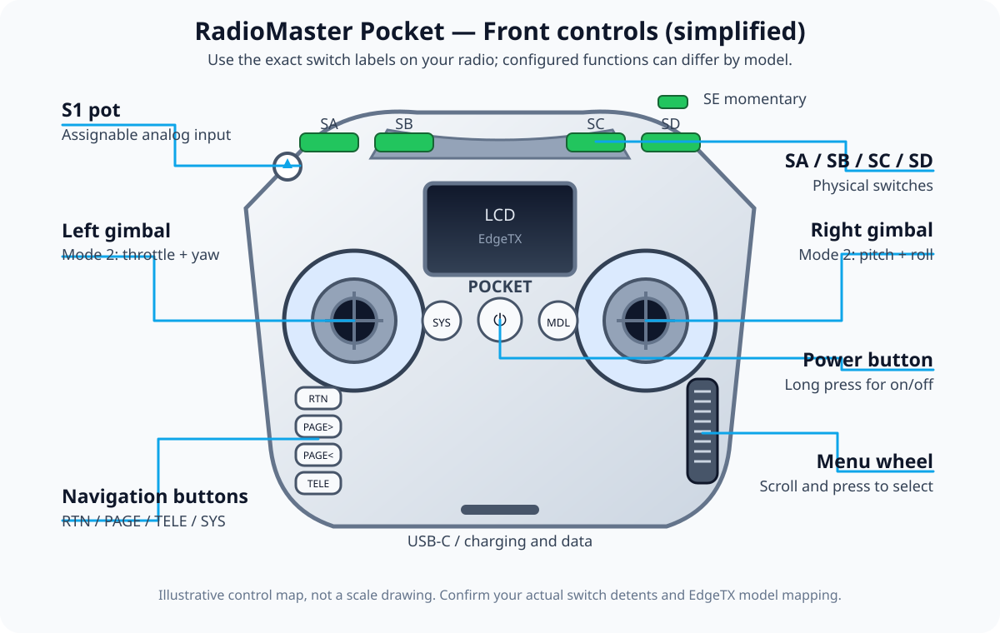
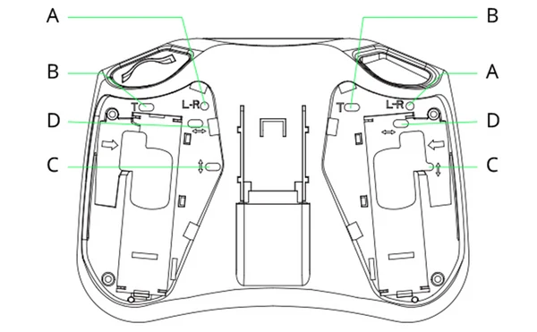

# 🎮 RadioMaster Pocket — Button, Switch and Gimbal Guide

> **For your setup:** RadioMaster Pocket ELRS 2.4 GHz + EdgeTX + Liftoff. This guide separates the *physical controls* from the *functions you assign in software*. A switch does not automatically arm a real quad just because it is labelled SA or SD.

*Use this map to identify the physical controls before changing EdgeTX settings. Labels and menu behavior can vary by radio revision and EdgeTX version.*

Official product and manual references: [Pocket M2 product page](https://radiomasterrc.com/products/pocket-radio-controller-m2) · [RadioMaster manuals](https://radiomasterrc.com/pages/user-manuals) · [EdgeTX user manual](https://manual.edgetx.org/) · [USB Joystick setup](https://github.com/EdgeTX/edgetx-user-manual/blob/2.12/color-radios/model-settings/model-setup/usb-joystick.md).

## 🎥 RadioMaster Pocket setup video

Watch [RadioMaster Pocket — How To Set Up and Bind a Drone — Step by Step](https://www.youtube.com/watch?v=GgaWMvAHZi8) alongside this button guide. Compare menu names and binding/Betaflight steps with your exact Pocket, EdgeTX, ELRS and receiver versions. For simulator-only input, use USB joystick mode; binding a real drone receiver is a separate task.

## 0. First power-on and hardware safety (A1.8 quick-start guide)

The supplied RadioMaster Pocket A1.8 guide covers the front/rear layout and warns about the following:

- Fit/unfold the provided antenna **before** powering the internal RF module; transmitting without the antenna may damage the RF module.
- The Pocket is designed for two compatible **3.7 V 18650 Li-ion cells** (6.6–8.4 V system range; batteries are not included). Check polarity and cell condition, use only the supported chemistry and do not leave charging unattended.
- The guide's ELRS version recommends **Dynamic Power** and a packet rate of **500 Hz or lower** as a battery/heat trade-off. This is not a Liftoff USB setting, and it is not a reason to change RF configuration before you know the aircraft receiver and local radio rules.
- Avoid firmware updates until you have checked the exact Pocket/ELRS hardware variant, backed up settings and followed the current manufacturer's instructions.

The current [RadioMaster Pocket M2 page](https://radiomasterrc.com/products/pocket-radio-controller-m2) and [manual downloads](https://radiomasterrc.com/pages/user-manuals) are the source of truth if the supplied A1.8 guide and your radio's menus differ.

## 1. The front controls

| Control | What it does | Beginner recommendation |
|---|---|---|
| **Left gimbal** | The two axes controlled by the left stick. | In **Mode 2**, vertical is throttle and horizontal is yaw. Move one axis at a time when calibrating Liftoff. |
| **Right gimbal** | The two axes controlled by the right stick. | In **Mode 2**, vertical is pitch and horizontal is roll. Practise small, smooth movements rather than snapping to the edges. |
| **SA** | Latching, 2-position switch on the physical radio layout. | Choose an easy-to-reach safety-related function only after checking the switch in EdgeTX and Betaflight. Do not guess which direction means ON. |
| **SB** | Position switch; normally a multi-position latching switch. | Leave unassigned until you understand your model's switch mapping. Useful for a deliberately configured flight mode only. |
| **SC** | Position switch; normally a multi-position latching switch. | Same rule as SB: identify positions on the radio and confirm the associated channel in EdgeTX. |
| **SD** | Latching, 2-position switch on the physical radio layout. | Often a convenient second switch for a deliberate auxiliary function. Configure and test it; its function is not built in. |
| **SE** | Momentary switch; it returns when released. | Avoid using it as the only arm/disarm control. It can be useful for a momentary simulator action or a function you intentionally configure. |
| **S1 pot** | Rotary analog control. | Leave at a known middle position unless a model explicitly uses it. A pot can accidentally affect an assigned channel. |
| **Trim buttons** | Adjust small channel trims in models that use trims. | For FPV multirotor Acro, leave trims centred; do not use trims to fix drift. Check calibration and flight-controller setup instead. |
| **LCD** | Shows the active model, EdgeTX pages, alerts and telemetry. | Before any real aircraft use, confirm the correct model name and RF mode on-screen. |
| **SYS** | System/tools navigation shortcut. | Use it to find the Tools menu and the ExpressLRS Lua script. Short/long-press behaviour and page names can vary by EdgeTX release. |
| **MDL** | Model-related navigation shortcut. | Use model management to select/create a model; check the displayed model before powering a real quad. The precise short/long press action is firmware/page dependent. |
| **RTN** | Return/back/cancel. | Use it to back out of a menu; do not assume a change was saved until the radio shows the expected result. |
| **PAGE> / PAGE<** | Move between menu tabs/pages. | Use the page buttons plus wheel to navigate rather than changing unknown settings in a hurry. |
| **TELE** | Telemetry/screen shortcut on this radio family. | Use it for telemetry or channel monitoring where enabled; the exact page depends on the EdgeTX version and configuration. |
| **Menu wheel** | Scroll through options; press to select/enter. | Scroll slowly and confirm the highlighted item before pressing. |
| **Power button** | Power control. | Follow the radio's long-press behaviour to turn it on/off. Check the model banner after startup. |
| **USB-C port** | Charging and USB data. | Liftoff needs a **data-capable cable** and USB Joystick mode, not a charge-only cable. |
| **SD-card slot** | Firmware, sound packs and radio SD-card content depending on setup. | Do not update EdgeTX or replace SD-card contents until you know the exact radio/hardware target and have a backup. |
| **3.5 mm DSC/trainer port** | Wired trainer-related connection on supported equipment. | Not the first choice for PC simulator setup; use USB Joystick mode first. |
| **Antenna** | Radio's 2.4 GHz RF antenna. | Unfold/install before turning on internal RF. Never operate the RF module with the antenna missing. |
| **External module bay** | Accepts compatible Nano-size RF modules. | Not needed for your internal ELRS setup or Liftoff. Confirm module dimensions and protocol before buying an external module. |
| **Removable stick ends** | Stick-end storage / transport convenience. | Ensure stick ends are secure and comfortable before practice. |

The manufacturer's current product page lists ELRS and CC2500 versions, EdgeTX, two 18650 cells (not included), Hall-effect gimbals, a foldable antenna and a Nano-size module bay. Always verify your exact radio variant and regional firmware label on the radio/package before flashing or ordering a receiver.

## 2. Gimbal adjustments: use the picture, not guesswork

The manufacturer describes the adjustment points as follows:

- **L–R / Mode 1–Mode 2 mechanism:** changes whether the relevant vertical stick self-centres. A throttle axis normally does **not** self-centre; the pitch/elevator axis normally does. Make the change only if you deliberately need to convert stick mode, and follow the exact labels/diagram on your radio.
- **T — throttle tension:** clockwise increases throttle-stick tension; counter-clockwise decreases it.
- **C — vertical tension:** clockwise increases vertical-axis tension; counter-clockwise decreases it.
- **D — horizontal tension:** clockwise increases horizontal-axis tension; counter-clockwise decreases it.

Make tiny adjustments and test the full stick travel gently. Do not force screws to their stop. If unsure about stick mode, ask an experienced pilot to identify it before changing the mechanism.

## 3. Know your stick mode

Most FPV tutorials and this guide assume **Mode 2**:

| Stick | Horizontal axis | Vertical axis |
|---|---|---|
| Left | Yaw | Throttle (normally non-self-centering) |
| Right | Roll | Pitch (normally self-centering) |

To verify: with the radio on, move one stick axis at a time and watch the EdgeTX channel monitor. The model may be mapped differently; the channel monitor is the source of truth for your current setup.

## 4. Create two separate EdgeTX models

Using separate model profiles helps prevent simulator settings from being confused with a real quad's RF configuration.

### Model A — `SIM-Liftoff`

- [ ] Create or select a dedicated model named `SIM-Liftoff`.
- [ ] Connect the Pocket using a known data-capable USB-C cable.
- [ ] If prompted, choose **USB Joystick** rather than mass storage. Menu wording differs by EdgeTX version.
- [ ] For USB joystick use, turn **internal and external RF modules off** as recommended in the EdgeTX manual.
- [ ] Start with EdgeTX's **Classic** USB Joystick mode. Advanced mode is available on supported firmware but adds channel/axis configuration steps.
- [ ] In the operating system and Liftoff, calibrate or map roll, pitch, throttle and yaw.
- [ ] Move one axis at a time; confirm the right axis moves and direction feels correct.
- [ ] Confirm throttle low is the game's true minimum, not the midpoint.
- [ ] Save the Liftoff input profile and record OS / EdgeTX version / cable if you had to troubleshoot.

### Model B — `QUAD-ELRS` (only when you own a compatible real quad)

- [ ] Create a separate model profile; do not use the simulator profile for flight.
- [ ] Select the Internal RF protocol appropriate to the ELRS module (normally **CRSF** in EdgeTX for ExpressLRS radios; menu labels depend on firmware).
- [ ] Check the ExpressLRS TX module firmware version and hardware target before updating.
- [ ] Set up the receiver and flight controller using official ExpressLRS and Betaflight documentation for your exact hardware.
- [ ] Bind with a matching binding phrase or the currently documented binding method.
- [ ] Check channels and switches in Betaflight, including the actual ARM range in the Modes tab.
- [ ] Verify failsafe, motor order/direction and disarm behaviour with **all propellers removed**.
- [ ] Save a radio model backup and a Betaflight configuration backup before later customisation.

> [!WARNING]
> USB simulator mode does not bind the radio to a drone. A successful ELRS bind does not prove a real aircraft safe. Do not install propellers during firmware, USB, motor, receiver or bench tests.

## 5. A safe beginner switch-mapping method

Do not copy somebody else's switch map blindly. A reasonable *planning example* is to reserve a clear 2-position switch for ARM, another switch for a beeper, and leave the rest unassigned until needed. For a real Betaflight quad, configure the mode in Betaflight, observe the AUX channel range, and verify the disarm direction with propellers removed. Check ExpressLRS arming-state configuration in the current ELRS docs as well.

For the simulator, map controls inside Liftoff's controller setup; that mapping is separate from Betaflight.

## 6. Pocket-to-Liftoff troubleshooting

| Symptom | Check in this order |
|---|---|
| PC does not see a controller | Try a confirmed data USB-C cable, another port, reconnect after selecting USB Joystick, and check OS controller settings. |
| Radio offers storage, not joystick | Choose the joystick option for the simulator. If not offered, check the EdgeTX version/manual for your exact screen and USB mode. |
| One stick axis is wrong | Re-run Liftoff calibration; move one axis at a time; then inspect the EdgeTX channel monitor. Change one setting at a time. |
| Throttle springs back to centre | Confirm you are using the intended stick mode and that the throttle gimbal is mechanically set as intended. Refer to the rear adjustment image above. |
| Switch moves the wrong control | Inspect EdgeTX Inputs/Mixes/Channel Monitor and Liftoff's own binds. Do not change several channel orders at once. |
| ELRS LUA script missing | Check the radio variant, EdgeTX/SD-card content and internal module firmware. Use the current RadioMaster manual; don't flash a random target. |
| Receiver won't bind | Compare the exact TX/RX firmware major versions, band and hardware target; check whether a binding phrase is set on both. See [ExpressLRS binding](https://www.expresslrs.org/quick-start/binding/). |

## 7. Video walkthroughs supplied for this guide

These four videos were supplied as supporting references. The webpages were not consistently retrievable for full titles/captions during this documentation pass, so this guide does not claim a transcript-derived summary for the first three. Use the checklist below while watching and write the timestamp for any step that differs from your firmware.

1. [Video reference 1](https://youtu.be/wIqyAFQszfM) — capture title, channel, relevant chapter/timecode, and what you verified on your own radio.
2. [Video reference 2](https://youtu.be/fyJ-e2zuqB4) — capture title, channel, relevant chapter/timecode, and any menu/version assumptions.
3. [Video reference 3](https://youtu.be/8eGgAS2n3lQ) — capture title, channel, relevant chapter/timecode, and what was different on your setup.
4. [RadioMaster Pocket getting started guide](https://youtu.be/cuzHn2Uw0q8) — use alongside this page and the official manual. Pause at each menu action, compare it with your radio, and log any firmware/UI difference.

### While watching, check off the following

- [ ] Identify if the example radio is Pocket ELRS or CC2500; do not copy variant-specific steps blindly.
- [ ] Confirm which EdgeTX screen/version the video uses.
- [ ] Record the exact model name used in the video.
- [ ] Note whether the tutorial configures a simulator model or a real aircraft model.
- [ ] Before any real-quad setup, save configuration backups and remove propellers.
- [ ] Write timestamp + takeaway + whether you tested the step on your own radio.

## 8. Tiny practice plan for today

- [ ] 5 minutes: name each gimbal axis and switch without looking at notes.
- [ ] 5 minutes: open the channel monitor; move one axis/switch at a time.
- [ ] 5 minutes: connect to Liftoff and confirm four primary axes.
- [ ] 5 minutes: practise smooth wide turns, then record one win and one next focus.

No need to do all 20 minutes in one sitting. Five focused minutes still count.
