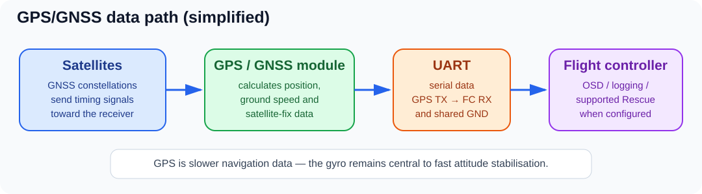

# 🧭 GPS, GNSS and Flight-Controller Boards

*Conceptual data path only; confirm UART pads, voltage and wiring in the exact FC and GNSS module manuals.*

GPS is useful, but it is optional on many racing/freestyle FPV quads. Learn what the module sends to the flight controller before buying one or enabling rescue/navigation features.

## 1. GPS vs GNSS vs compass vs barometer

- **GNSS** is the general term for satellite navigation systems (GPS, Galileo, GLONASS, BeiDou, etc.). A module may receive multiple constellations.
- **GPS** is one GNSS constellation; hobby listings often use “GPS” as shorthand for the complete GNSS receiver module.
- **Compass / magnetometer** measures the local magnetic field and can help estimate heading. It is often added to an external GPS module, but it is not the same sensor as GPS.
- **Barometer** estimates changes in altitude from air pressure. Some FC boards include one even when they have no GPS.
- **Gyro + accelerometer (IMU)** measure rotation and acceleration/orientation for flight stabilisation. They operate much faster than GPS and form the core of the fast attitude control loop.

## 2. Types of GPS/GNSS hardware you will see

*Example compact module photo from ReadyToSky's BN-220 listing. See the [Betaflight GPS tab](https://betaflight.com/docs/wiki/app/gps-tab) and the exact module's data sheet for supported protocols and wiring.*

| Module style | What it means | Typical use / cautions |
|---|---|---|
| Compact GNSS module with ceramic patch antenna | Small receiver board and antenna in one package | Common on small quads; check mounting orientation and whether there is a magnetometer |
| GNSS + compass | Satellite receiver plus magnetic heading sensor | Larger/more complex; keep it away from motor current, battery wires, magnets and magnetic hardware; connect extra I²C wires only if the module includes them |
| Newer multi-constellation module (for example M10 generation) | Newer chipset can use supported constellations and may acquire/track satellites differently from older models | “Newer” does not automatically guarantee accuracy on a particular frame; compare supported firmware protocol, size, antenna and update rate |
| Dual-frequency / high-precision GNSS | Uses more than one signal band and/or more sophisticated positioning hardware | Usually more expensive and not necessary for basic OSD speed or simple GPS Rescue on a normal freestyle quad |
| GPS included on a larger autopilot / integrated assembly | GPS could be external, integrated, or part of a broader navigation system | Check exactly which sensors and firmware functions are supported; do not assume every “GPS-ready” FC includes a GPS receiver |

This is a technology overview, not a shopping ranking. “M8”, “M9” and “M10” generally identify receiver-chip families, while the module's antenna, constellation support, interface, firmware and placement also matter.

## 3. How GPS talks to the FC

Most compact FPV GPS modules connect to a **UART serial port**. Typical wiring is:

- GPS **TX → FC RX** on the selected UART.
- GPS **RX → FC TX** on that UART, if configuration needs the return path.
- GPS power/VCC → a voltage supported by that exact module and FC output.
- GPS GND → FC GND.
- If the module includes a compass, SDA/SCL may also need connection to supported I²C pins.

Use the exact board's wiring diagram. Connector shape and wire color are not a reliable pinout standard.

Betaflight's GPS configuration supports protocols such as **UBLOX** (common), NMEA for compatible modules, and MSP for modules using that protocol. Select the protocol and UART according to your hardware and firmware version. Confirm the FC actually sees a valid 3D fix and sensible satellite/position data before relying on any GPS feature.

## 4. What happens after GPS data reaches the FC?

The GPS receiver estimates satellite-based position and ground motion and sends data to the FC. Firmware can then use it for supported features such as:

- GPS coordinates, speed, distance-to-home and satellite information in the OSD.
- Flight logging / Blackbox context.
- GPS Rescue or navigation features, **when the flight firmware and exact configuration support them**.

GPS is not the fast stabilisation sensor. A GNSS update is much slower than gyro measurements. In Betaflight, the gyro-based PID loop keeps controlling attitude; GPS can provide position/speed information for higher-level features.

## 5. GPS Rescue is not a guaranteed Return-to-Home

Betaflight calls its feature **GPS Rescue**. It is intended as a recovery aid if the control/video link is lost or a pilot activates rescue, but it is not a substitute for line-of-sight flying, link planning, or a verified failsafe configuration. A bad fix, incorrect home point, compass interference, poor level-mode setup, wrong tune, inadequate power, wind or configuration error can make rescue fail.

Before enabling it, read the current [Betaflight GPS Rescue guide](https://betaflight.com/docs/wiki/guides/current/GPS-Rescue) and [GPS tab documentation](https://betaflight.com/docs/wiki/app/gps-tab) for your installed firmware. The guide calls for careful testing and explicitly warns that GPS Rescue may not bring the aircraft home.

- [ ] Confirm the GPS protocol, UART and wiring.
- [ ] Confirm a stable 3D fix and home-point behaviour in the actual field.
- [ ] Verify the accelerometer/level-mode behaviour if required by your firmware's rescue setup.
- [ ] Save the existing FC configuration before enabling features.
- [ ] Test exactly according to the current firmware guide in a controlled, safe setting.
- [ ] Never rely on GPS Rescue as permission to fly out of sight or beyond a conservative link budget.

## 6. Flight-controller board types: stack vs AIO

### FC + 4-in-1 ESC stack

A stack normally means one **flight-controller board** mounted above a separate **4-in-1 ESC board**, linked by a harness or solder pads. It is common in 3.5–7 inch builds where the pilot wants more room, current capacity or serviceability. A specific FC may include a barometer, OSD, Bluetooth, blackbox memory, many UARTs, or a digital-VTX connector—but these features vary by revision.

SpeedyBee's [F405 V3 documentation](https://www.speedybee.com/speedybee-f405-v3-30x30-flight-controller/) describes the exact board's STM32F405 MCU, BMI270 gyro, barometer, OSD, Bluetooth, multiple UARTs and 30.5×30.5 mm mounting. Its page marks that exact F405 V3 product as discontinued, so treat it as an example of the stack architecture—not a current purchase recommendation.

### AIO (all-in-one)

An AIO combines the FC and ESC in one PCB to save size and wiring. Some models also include a receiver, OSD, current sensor, barometer or VTX. This is useful for tiny whoops and toothpick/micro builds, but check the exact AIO features.

BETAFPV's [F4 1S 12A AIO family](https://betafpv.com/products/f4-1s-12a-flight-controller) illustrates the small-board approach. BETAFPV product versions differ: older variants list SPI ELRS or FrSky receiver options, while the [V3 page](https://betafpv.com/products/f4-1s-12a-aio-brushless-flight-controller-v3-0) describes serial ELRS, a barometer, current sensing, Blackbox, and 1–2S support. Exact MCU versions (STM32F405 vs AT32F435), connectors, receiver and firmware targets differ. **Never flash firmware for a similar-looking revision.**

## 7. Comparison at a glance

| Question | FC + ESC stack | AIO |
|---|---|---|
| Physical design | Two main boards stacked | FC and ESC share one board |
| Common use | Larger freestyle/racing builds; more space for peripherals | Tiny whoops, toothpick and compact builds |
| Repair implications | A separate ESC board can sometimes be replaced independently | Damage to one integrated section may mean replacing the full AIO |
| Selection priorities | Mounting pattern, ESC current, battery cell support, UARTs, BECs and connector layout | Frame/mounting fit, cell count, ESC capacity, motor connectors/pads, receiver variant, BEC and supported VTX |
| What to verify | Exact FC target and ESC firmware, wiring harness/pinout, power outputs | Exact AIO revision, onboard receiver protocol/firmware, output voltage, ESC rating, supported Betaflight target and peripheral support |

## 8. Pre-purchase / configuration checklist

- [ ] Confirm the exact board revision and firmware target, not just “F4/F405” or “AIO”.
- [ ] Check motor/ESC current, battery cell-count range, BEC output voltage/current and capacitor requirements.
- [ ] Count available UARTs for receiver, GPS, digital VTX and other peripherals.
- [ ] Confirm whether GPS, compass, barometer, OSD and Blackbox are built in or external.
- [ ] Check frame mounting pattern and board dimensions.
- [ ] Check receiver protocol (SPI ELRS vs serial ELRS is an important distinction) and firmware compatibility.
- [ ] Save a backup before firmware changes.
- [ ] Remove all propellers before setup, firmware work and motor tests.

## Official references

- [Betaflight GPS tab](https://betaflight.com/docs/wiki/app/gps-tab)
- [Betaflight GPS Rescue guide](https://betaflight.com/docs/wiki/guides/current/GPS-Rescue)
- [Betaflight setup guide](https://betaflight.com/docs/wiki/getting-started/setup-guide)
- [SpeedyBee F405 V3 FC](https://www.speedybee.com/speedybee-f405-v3-30x30-flight-controller/)
- [BETAFPV F4 1S 12A AIO FC](https://betafpv.com/products/f4-1s-12a-flight-controller)
- [BETAFPV F4 1S 12A AIO V3](https://betafpv.com/products/f4-1s-12a-aio-brushless-flight-controller-v3-0)
- [ArduPilot GPS/Compass hardware overview](https://ardupilot.org/copter/docs/common-positioning-landing-page.html)
