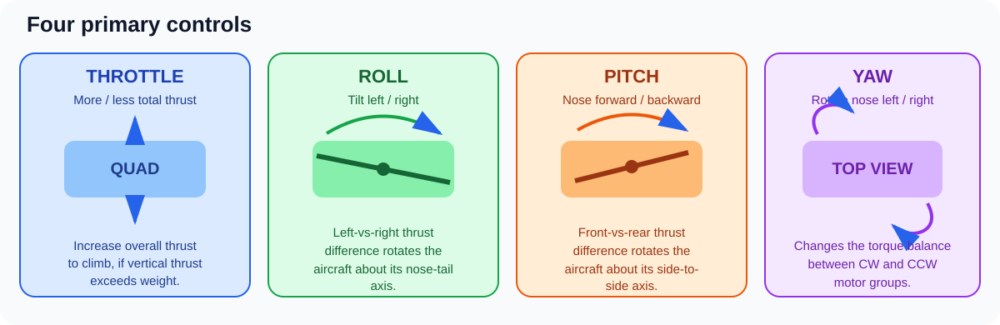
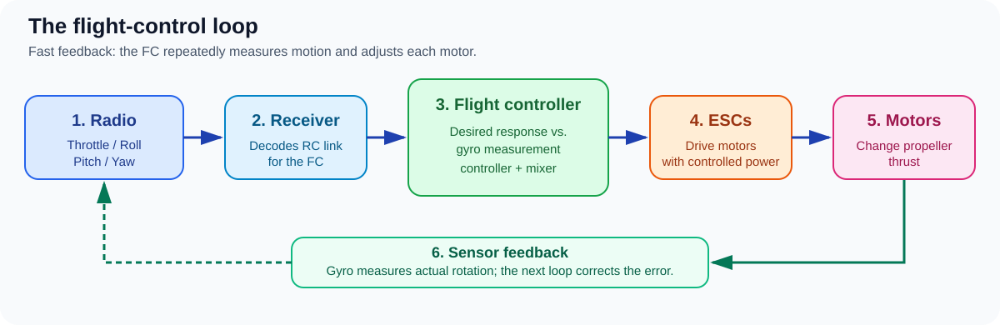

# 🚁 buildFPV Learning Guide

This is the main entry point for the FPV learning material maintained **inside this repository**. Follow the sequence below: first understand the whole aircraft, then learn how it moves, then practise in a simulator before buying or configuring hardware. You can revisit any stage at any time.

> [!TIP]
> A useful first session is 10–15 minutes in Liftoff. Practise one control at a time, then record one thing that improved and one goal for the next session. Keep real aircraft disarmed and propellers removed while learning setup or testing motors.

## Beginner path

> [!IMPORTANT]
> **Mandatory beginner video course before your first real flight:** complete the [Learn to fly an FPV drone (for total beginners) playlist](https://www.youtube.com/playlist?list=PLwoDb7WF6c8lCKhQOTy-Vb9LfW0VAIrTP) in sequence while practising in Liftoff. This is a buildFPV learning requirement, **not an official licence or certification**; continue to check safety requirements and current local rules.

1. **Understand the aircraft systems** — [FPV system basics](01-fpv-basics.md). Learn the control link, flight controller, propulsion, video link and power path.
2. **Understand the aircraft physically** — [How an FPV quad works](07-how-fpv-drones-work.md). Learn thrust, roll/pitch/yaw, opposite motor rotation and the flight-control feedback loop.
3. **Connect your RadioMaster Pocket to the simulator** — [Pocket ELRS notes](03-pocket-elrs.md) and the [Pocket control guide](06-pocket-button-guide.md). USB joystick input is separate from binding to a real aircraft.
4. **Build repeatable control** — [Liftoff simulator training](02-simulator-training.md). Progress from single-axis drills to circuits, figure-eights, gates, landing and calm recovery.
5. **Plan before purchasing** — [First-build planning](04-first-build.md) and [buying parts in India](wiki-source/Buying-Parts-in-India.md), a reference page kept within this repository. Confirm compatibility and the complete budget before ordering.
6. **Learn configuration and safety** — [Practical FPV checklists](checklists.md), [Betaflight basics](https://betaflight.com/docs/wiki/getting-started), and [bench safety / flight readiness](wiki-source/Bench-Safety-and-Flight-Readiness.md). Keep props off for setup and motor checks.
7. **Learn video and navigation systems** — [Video, antennas and range](08-video-antennas-and-range.md) and [GPS/GNSS and flight-controller examples](09-gps-and-flight-controller-examples.md).
8. **Keep improving** — [Phased learning roadmap](05-roadmap.md), [daily learning log](learning-log/README.md), and the [daily-session template](learning-log/templates/daily-session.md).

## Visual guides

Use these diagrams as a quick visual index. Read the matching section for the explanation; do not use concept art as a wiring or motor-direction reference.

### 1. Whole-aircraft overview

*Concept artwork for orientation only. Component placement varies by build; verify pinouts and board revisions against the exact manufacturer's documentation.*

### 2. Understand the four flight controls

Throttle changes the overall thrust request. Roll, pitch and yaw change the aircraft's rotation by adjusting motor outputs in different ways. The exact motor mix depends on frame orientation, firmware and configuration.

### 3. Follow the control loop

The radio sends pilot commands, the flight controller compares requested and measured movement, and the ESCs change motor power. The gyro drives fast stabilisation; GPS is a slower source of navigation data, not a replacement for the gyro.

### Continue into focused guides

- [How an FPV quad works](07-how-fpv-drones-work.md) — lift, propeller rotation, flight axes and feedback.
- [RadioMaster Pocket buttons and switches](06-pocket-button-guide.md) — physical controls, gimbal adjustments, EdgeTX and Liftoff calibration.
- [Video, antennas and range](08-video-antennas-and-range.md) — camera-to-goggles signal path and antenna trade-offs.
- [GPS and flight-controller examples](09-gps-and-flight-controller-examples.md) — GNSS data flow, UARTs, AIO vs stack and GPS Rescue caveats.

## Optional learning extensions

- [Drone Coding and Machine Learning](drone-coding-and-ml.md) — optional advanced work after simulator and system basics.
- [India outdoor flying rules and video resources](wiki-source/India-Outdoor-Flying-Rules.md) — treat videos as supplementary and verify all current requirements through official DGCA / Ministry of Civil Aviation sources and Digital Sky.

## Practice cadence

At the end of a session, write down:
- **Practised:** the exact drill or configuration change.
- **Observed:** what happened, including crashes or unexpected behavior.
- **Next step:** one small, measurable action.
- **Evidence/source:** simulator settings, firmware version, official manual or measurement when relevant.

## Safety rules that always apply

- Remove all propellers during firmware work, USB setup, receiver checks and motor tests.
- Disconnect the LiPo before soldering or investigating a possible short.
- Follow the VTX manufacturer's antenna and cooling requirements before powering it.
- Back up radio and flight-controller configuration before changing firmware/settings.
- Do not assume GPS Rescue guarantees return-to-home.
- Confirm current local airspace and radio rules through official sources before outdoor flights.

## How to use images

Project-owned diagrams live in [`docs/assets/`](assets/README.md), and pages reference them using repository-relative paths. This keeps core learning visuals versioned alongside the explanations. External manufacturer/retailer photos are examples only; they can move or change, so the linked product page is the reference for current specifications. An image is never a substitute for a revision-specific wiring diagram.
