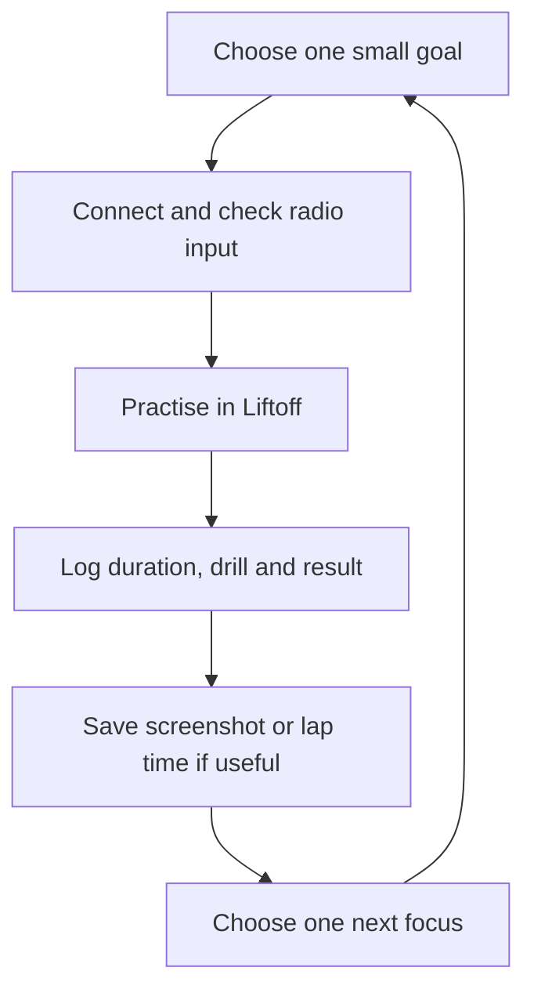

# 🚁 buildFPV Wiki — Learn. Practise. Build. Fly safely.

  

Welcome to the beginner-first field guide for [`luckyhegde6/buildFPV`](https://github.com/luckyhegde6/buildFPV). Start with your RadioMaster Pocket ELRS and Liftoff. Build reliable stick control and technical understanding before buying a complete quad.

> [!TIP]
> **The daily habit:** open Liftoff, choose one drill, practise for 5/10/15/20/30+ minutes, then record one win and one next step. If you skip a day, just restart the next day—no guilt, no catch-up marathon.

## 🧭 Pick a path

| Path | Goal | Start here |
|---|---|---|
| 🟢 **Start now** | Radio + simulator setup | [[Getting Started]] · [[Pocket ELRS and Liftoff]] · [[RadioMaster Pocket Button Guide]] |
| 🎮 **Build the habit** | Repeatable daily practice | [[Daily Liftoff Routine]] · [[Learning Journal]] · [[Practice Skills and Race Times]] |
| 🎛️ **Pocket controls** | Buttons, switches, gimbals and video-study notes | [[RadioMaster Pocket Button Guide]] · [[Pocket Video Walkthrough Notes]] |
| 🧠 **Understand the aircraft** | Control, power, flight and video systems | [[FPV System Basics]] · [[How FPV Drones Work]] · [[ExpressLRS Basics]] · [[Betaflight Basics]] |
| 📡 **Understand video and GPS** | VTX/VRX, antenna patterns, GPS data and FC boards | [[Video Antennas VTX VRX]] · [[GPS and Flight Controllers]] |
| 🛒 **Plan purchases** | Compare compatible parts and local stores | [[Buying Parts in India]] · [[First Build Checklist]] |
| 🔧 **Configure carefully** | Backups, customisations and troubleshooting | [[Configuration and Customisation]] · [[Troubleshooting]] |
| 🛡️ **Fly responsibly** | Bench, pre-flight and India checks | [[Bench Safety and Flight Readiness]] · [[India Outdoor Flying Rules]] |
| 🖼️ **See real hardware** | Real FPV build photos, FC/AIO boards, antennas and GPS | [[Hardware Gallery]] |
| 🌱 **Explore later** | Open source, digital video, stabilization | [[BuildFPV Projects Library]] · [[Video Systems and Goggles]] · [[References]] |

## 🖼️ FPV visual overview

*AI-generated overview for orientation: it combines the control loop, flight axes, propulsion, video, antenna and GPS concepts. Treat it as a visual index, not as a wiring diagram, exact motor-order instruction or product specification. For the verified details, use [[How FPV Drones Work]], [[Video Antennas VTX VRX]], and [[GPS and Flight Controllers]].*

## 🗺️ The learning loop

## ✅ Beginner rules of the road

- Use official documentation for the exact product and firmware version.
- **Remove every propeller** during setup, USB configuration, firmware work, motor testing and bench troubleshooting.
- Disconnect the battery before soldering or changing wiring.
- Save a configuration backup before meaningful changes.
- A radio bind is not a full safety check; receiver mapping, failsafe, motors, video and power also need verification.
- Check current Indian airspace and radio requirements before outdoor operations. This Wiki is educational, not legal advice.

## 📅 Habit tracker

- [ ] Today: one Liftoff session (5 min is enough)
- [ ] Log the radio used and session duration
- [ ] Record one win and one difficulty
- [ ] Add a screenshot or lap time if you captured one
- [ ] Pick exactly one next-session focus

For journaling templates, use the [Learning Journal](Learning-Journal) page or the repository's `docs/learning-log/templates/` files. See the [project source](https://github.com/luckyhegde6/buildFPV) for versioned docs and optional issue forms.
