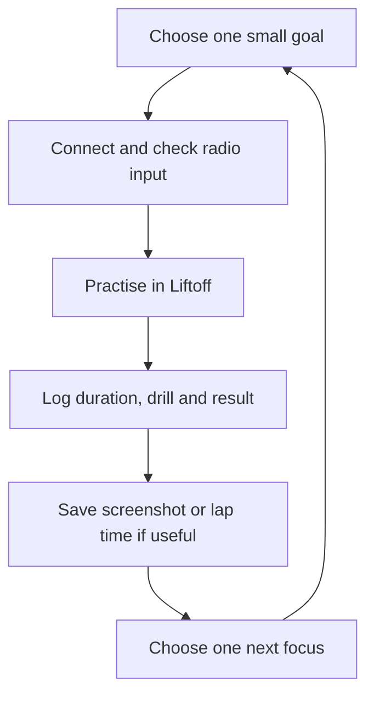

# 🚁 buildFPV Wiki — Learn. Practise. Build. Fly safely.

  

Welcome to the beginner-first field guide for [`luckyhegde6/buildFPV`](https://github.com/luckyhegde6/buildFPV). Follow the learning order below: understand the parts of an FPV system and how a drone works, learn your RadioMaster Pocket RC transmitter, then study the core links and software before starting the structured Liftoff simulation roadmap.

> [!TIP]
> **The daily habit:** open Liftoff, choose one drill, practise for 5/10/15/20/30+ minutes, then record one win and one next step. If you skip a day, just restart the next day—no guilt, no catch-up marathon.

## 🧭 Pick a path

| Order | Learn this first | Open these pages |
|---|---|---|
| **1. Parts of an FPV system** | Identify the frame, motors, props, battery, camera, video link, receiver and flight controller | [[FPV System Basics]] · [[Hardware Gallery]] |
| **2. Drone basics: how it works** | Understand lift, propeller directions, throttle, roll, pitch, yaw and the control loop | [[How FPV Drones Work]] |
| **3. Your RC transmitter** | Learn the RadioMaster Pocket controls, switches, gimbals, USB mode and safe simulator profile | [[RadioMaster Pocket Button Guide]] · [[Pocket ELRS and Liftoff]] |
| **4. Core FPV basics** | Separate the control link, flight-controller firmware, video system and GPS | [[ExpressLRS Basics]] · [[Betaflight Basics]] · [[Video Systems and Goggles]] · [[Video Antennas VTX VRX]] · [[GPS and Flight Controllers]] |
| **5. Simulation roadmap** | Connect the radio, calibrate in Liftoff, practise in stages, and track progress | [[Getting Started]] · [[Simulator Training]] · [[Daily Liftoff Routine]] · [[Practice Skills and Race Times]] · [[Learning Journal]] |
| **6. Prepare for a real build** | Learn bench safety, compare parts, and troubleshoot carefully before buying or flying | [[First Build Checklist]] · [[Buying Parts in India]] · [[Bench Safety and Flight Readiness]] · [[India Outdoor Flying Rules]] |
| **7. Continue exploring** | Configuration, projects, and deeper references | [[Configuration and Customisation]] · [[Troubleshooting]] · [[BuildFPV Projects Library]] · [[References]] |

## 🖼️ FPV visual overview

*AI-generated overview for orientation: it combines the control loop, flight axes, propulsion, video, antenna and GPS concepts. Treat it as a visual index, not as a wiring diagram, exact motor-order instruction or product specification. For the verified details, use [[How FPV Drones Work]], [[Video Antennas VTX VRX]], and [[GPS and Flight Controllers]].*

## 🗺️ The learning loop

## ✅ Beginner rules of the road

- Use official documentation for the exact product and firmware version.
- **Remove every propeller** during setup, USB configuration, firmware work, motor testing and bench troubleshooting.
- Disconnect the battery before soldering or changing wiring.
- Save a configuration backup before meaningful changes.
- A radio bind is not a full safety check; receiver mapping, failsafe, motors, video and power also need verification.
- Check current Indian airspace and radio requirements before outdoor operations. This Wiki is educational, not legal advice.

## 📅 Habit tracker

- [ ] Today: one Liftoff session (5 min is enough)
- [ ] Log the radio used and session duration
- [ ] Record one win and one difficulty
- [ ] Add a screenshot or lap time if you captured one
- [ ] Pick exactly one next-session focus

For journaling templates, use the [Learning Journal](Learning-Journal) page or the repository's `docs/learning-log/templates/` files. See the [project source](https://github.com/luckyhegde6/buildFPV) for versioned docs and optional issue forms.
